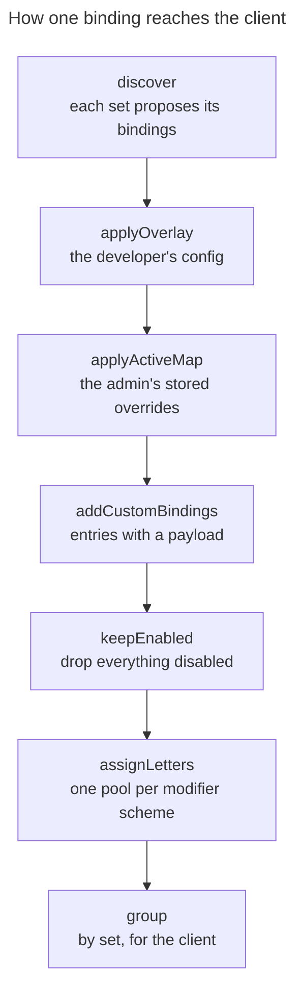

# Resolution

How a set of registered resources becomes a keymap the browser can act on. This is the part of the
package with the most rules per line, so it is worth understanding the order before changing a stage.

## The pipeline

`ShortcutResolver::resolve()` runs seven stages in a fixed order. Order matters at almost every step.



**discover** asks every registered set what it wants to bind. A set that finds nothing applicable to
the current page returns an empty list — `TableSet` on a page with no table, `RowActionSet` where the
table exposes none of the registered names.

A page can also hold tables that are not its own. `hasNestedTables()` is true when the page shows a
relation manager or a header, footer or dashboard widget that is a table, and `hasTable()` counts
those, so such a page gets the table keys. A nested table is a Livewire component of its own that
renders after the page, so its row actions are unknown when the keymap is built: on such a page
`RowActionSet` keeps every registered name, and the cheatsheet marks each of those rows with
`data-fsk-presence`, showing it only while a row carrying that action is on the page. Nothing else is
detected. A table placed through the page's own `content()` schema or `Livewire::make()`, or a widget
placed through `getWidgetsSchemaComponents()`, gives the page no table keys unless the page is a table
page itself.

**applyOverlay** applies the developer's config. A forced letter is turned into a fixed key combination
immediately, before assignment, so the assigner routes everything else around it. A disable is only
flagged here, not removed.

**applyActiveMap** applies the admin's stored overrides the same way. Targets the map does not mention
pass through untouched, which is what makes a stored map a set of differences rather than a snapshot.
Because it runs second, a stored letter replaces a letter the overlay pinned for the same target, and a
stored disable turns that target off; a stored letter cannot bring back a target the overlay disabled.

**addCustomBindings** adds entries that carry a payload and have no convention binding — these are new
keys, not overrides. Only a set marked `AcceptsCustomBindings` accepts them, which stops a payload
attached to, say, a table target from displacing a real shortcut.

**keepEnabled** drops everything flagged disabled. It runs *before* assignment on purpose: a disabled
shortcut's letter returns to the pool instead of being reserved for something invisible.

**assignLetters** pools bindings by their effective modifier scheme and assigns within each pool, since
only bindings sharing a scheme can collide. Each binding takes the first free letter of its letter
hint — the label for navigation, the name for header actions, row actions and custom bindings — then
falls back through the alphabet. Keys reserved or claimed in the pool (see below) are never picked.
Bindings that already hold a forced combination keep it and are routed around.

**group** buckets the result by set and attaches each set's scheme, giving the shape the serializer
turns into JSON.

## Modifier schemes

| Set | Default scheme | Notes |
|---|---|---|
| `navigation` | leader `g` | shares a letter pool with `custom` |
| `custom` | leader `g` | admin-defined bindings |
| `global` | bare | current page's actions; shares the bare pool with `row-action` |
| `table` | bare | fixed keys, no letters assigned |
| `row-action` | bare | stable letters across the panel |

Schemes are configurable per set. A set the config never mentions keeps its convention, so removing a
line restores the default instead of silently turning shortcuts into bare keys. An unknown modifier
token throws rather than being ignored.

Sets sharing a scheme share a pool, so `navigation` and `custom` compete for letters with each other
but never with `global`.

## Forced letters

A forced letter is an overlay pin or a letter stored in the admin's active map. `forcedCombo()` turns
it into a key combination in the set's own scheme, and returns null in only two cases: the letter is
not a–z, or its key is reserved in that pool. The shortcut then keeps its automatic letter. Any other
forced letter works on any set, bare sets included. An overlay pin also switches on a header action
that runs on the click itself, which `GlobalSet` leaves off on bare keys; that is how such an action
gets a key.

In the assigner, a forced letter takes its key from an automatically lettered shortcut, which moves to
another free letter. When two forced letters land on one key in a pool, the first in pool order keeps
it and the later one is dropped. Pool order is discovery order: navigation before custom bindings,
header actions before row actions.

A row action's letter counts as forced, because `RowActionSet` sets it before the resolver runs (see
below). So pinning a row action onto a sibling's letter leaves two fixed combinations on one key, and
the one later in `->rowActions([...])` is dropped: with `['approve', 'reject']`, pinning `approve` to
`r` gives approve `R` and leaves reject with no key.

## Reserved and claimed keys

`KeyReservations` builds, per pool, the keys no letter may take. Every set implementing `ReservesKeys`
contributes its keys (the table's `/`, `J`, `K`, arrows and the rest), and every leader key goes into
the bare pool, since the leader is itself pressed bare. It is built from both registries at once,
because the navigation leader lives in the panel-wide registry but has to stay out of the bare pool
the page sets letter. It throws when a leader is one of the bare table keys, since pressing it would
start a wait instead of doing the table's job.

The plugin also refuses a pool split across the two registries. Each registry is lettered by its own
resolver, so `global` or `row-action` on the same scheme as `navigation` or `custom` could hand one key
to two shortcuts; that configuration throws, naming the set.

Row actions letter themselves. `RowActionSet` assigns over the full registered list, stepping around
the pool's reserved keys and the letters the overlay pins for other sets in that pool, then keeps only
the names the page has. The resulting codes are passed to the page resolver as claimed codes for the
pool: an automatic letter steps around them, so a header action's letter does not depend on which
tables the page has, while a forced letter may still take one.

## Key matching

Keys are matched on the physical key (`event.code`), not the produced character. A shortcut therefore
lands on the same physical key regardless of keyboard layout or text direction.

Pagination is the exception that proves the rule. In a right-to-left panel the arrows are swapped
server-side, because Filament flips its own previous and next controls, and a key that moved the wrong
way would be correct by physical position and wrong by meaning. Deciding it server-side also keeps the
reference page and the cheatsheet showing the key that actually fires.

## Precedence

When one key could match more than one active set, the client resolves in a fixed order:

```
custom > table > global > navigation
```

The order is by client handler, so row actions, which the `table` handler fires, sit at the table
tier. The cheatsheet does not mark precedence winners, because with the shipped sets no two groups can
reach the same combination: each pool is lettered by one resolver, the two resolvers' pools are kept
apart, and the table's fixed keys are reserved in both.

## What the client receives

The render hook injects a JSON block containing, per group, the set key, the client handler that fires
it, the held modifiers, the leader key (null when there is none), and the bindings. Each binding
carries its target, its physical key code, and an activation describing what to do: navigate to a
URL, click a selector, or run a named table behaviour. A custom binding whose selector is not valid CSS
or matches nothing does nothing when pressed, and a route the badge lookup cannot match gets no badge;
neither stops the rest of the keymap.

The split matters. The core stays free of URLs and selectors — it deals in targets and key
combinations — and `ClientMapSerializer` resolves those into something actionable using the same
providers that discovered them.

Handlers are keyed by set, but a set does not have to be fired by a handler of the same name.
`RowActionSet` has the key `row-action` and the handler `table`, because firing a row action needs the
table handler's focused-row cursor.

## Trigger-time authorization

A shortcut clicks a real Filament control or follows a real route. It never invents a privileged
action, and it never calls a Livewire method directly.

This is the whole security model, and it is why a custom binding's payload is restricted to exactly one
of a selector for an already-rendered element or a host-relative route. An unauthorized control is not
rendered, so there is nothing to click; an unauthorized route is stopped by middleware. A confirmation
modal appears because the real control was clicked, not because the plugin reimplemented one.
